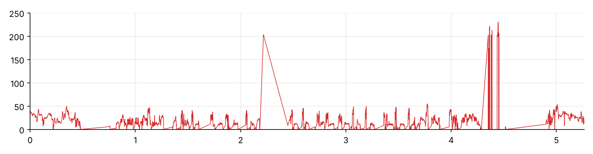
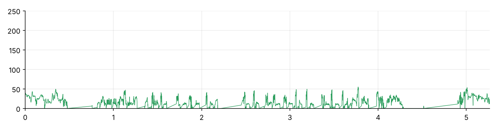
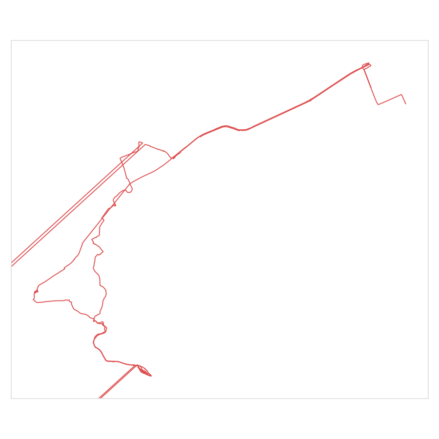
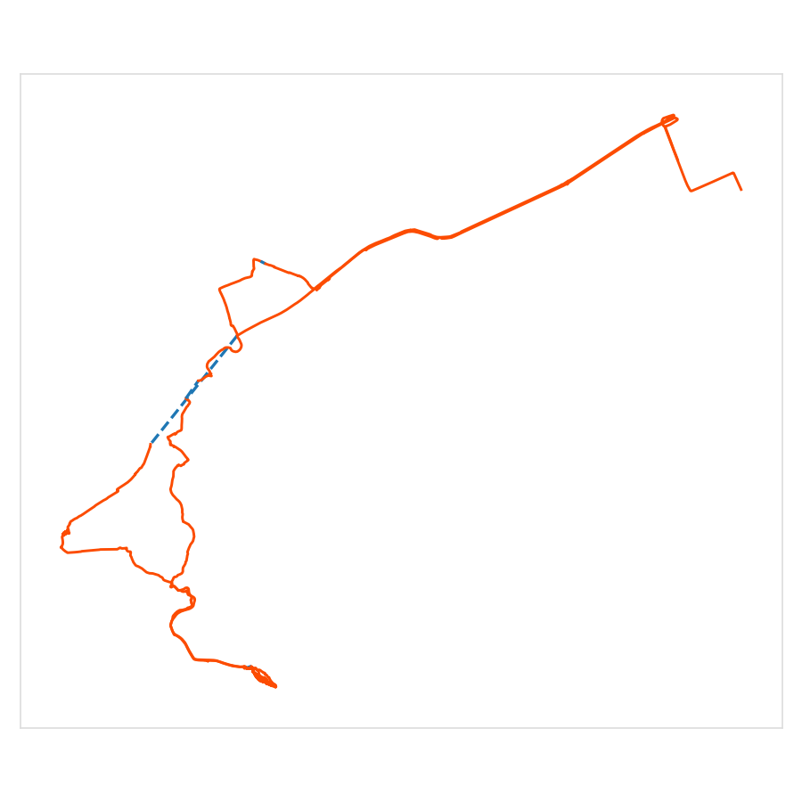

# fit-gps-spoof-fix: fix Strava / Garmin rides broken by GPS spoofing · виправлення активностей Strava після спуфінгу GPS

Repair Garmin/Strava cycling activities corrupted by GPS spoofing or jamming — the track "teleports" to Lima (or elsewhere), speed spikes to 150–250 km/h, and the distance gains kilometres you never rode.

It's an [Agent Skill](https://agentskills.io): drop it into Claude Code or any skills-compatible agent, upload your `.fit`, and ask it to fix the ride. The scripts also work on their own.

**Sound familiar?** Strava shows a 230 km/h max speed on a bike ride · your Garmin track jumps to Lima, Peru · the ride has 15 km you never rode · a straight line across the map · wrong distance after GPS jamming or electronic warfare (EW) interference.

## Українською

Виправляє велоактивності Garmin і Strava, зіпсовані **спуфінгом або глушінням GPS (РЕБ)**: трек «улітає» в Ліму (Перу), максимальна швидкість 200+ км/год, зайві кілометри, пряма лінія через пів карти. Скіл бере оригінальний FIT-файл, прибирає фейкову швидкість і дистанцію, стирає підмінені координати й зберігає пульс, каденс, висоту, час і справжній кілометраж із датчика швидкості на колесі. Потім пояснює, як перезалити активність у Strava.

**Знайомо?** Strava показує 230 км/год на велопоїздці · трек Garmin стрибає в Перу · у поїздці 15 км, яких ти не проїжджав · неправильна дистанція після тривоги · як виправити активність у Strava після РЕБ, не втративши лайки.

Встановлення й запуск описано нижче, англійською; сам скіл (`SKILL.md`) написаний українською.

## Before and after

A real 5-hour MTB ride in Kyiv, recorded on a Garmin with a wheel speed sensor.

**Speed over time.** Before: **71.38 km, max 230.5 km/h**. The spikes at about 2:10 and 4:20 are stops. The wheel sensor fell asleep, the watch switched to spoofed GPS speed, and it logged 15 km of "riding" at 200+ km/h while the rider stood still.



After: **56.32 km, max 54.8 km/h**. The 106 fake records have zero speed, and their distance is gone. Everything else is untouched.



**The map.** Before: the raw track. Each red line leaving the frame is a jump to Lima, Peru, about 12,000 km away, and 449 points were placed there. After: the same frame with the Lima points removed. The blue dashed segment is a gap with no real coordinates. It draws as a straight line, but its distance still comes from the wheel sensor. The first and last kilometre are cut from both maps for privacy.

| Before | After |
|---|---|
|  |  |

## Install

**Claude Code**

```bash
claude plugin marketplace add msemitkin/fit-gps-spoof-fix
claude plugin install fit-gps-spoof-fix@msemitkin
```

Or from inside a session: `/plugin install fit-gps-spoof-fix --marketplace msemitkin/fit-gps-spoof-fix`

**Other agents (Codex, Cursor, Gemini CLI, etc.)**

Copy the `skills/fit-gps-spoof-fix/` folder into your agent's skills directory (for example `~/.claude/skills/`, `~/.codex/skills/` or the project's skills folder — check your agent's docs).

**claude.ai**

Zip the `skills/fit-gps-spoof-fix/` folder and upload it as a custom skill in your claude.ai settings.

## How it works

**What spoofing does to the file.** When GPS is spoofed, the watch believes it's somewhere else, usually Lima, Peru, and "travels" there at 200–1400 km/h. When GPS is jammed, there's no fix at all. How much of the activity gets damaged depends on where your watch gets its speed from.

**With a wheel speed sensor** (most of the damage is fixable). As long as the wheel is turning, the watch takes speed and distance from the sensor, so the actual riding under spoofing is recorded correctly and only lat/lon are wrong. The fake kilometres build up **while you're stopped**. The sensor goes to sleep after a minute or two, the watch switches to GPS speed, the spoofed GPS cancels auto-pause, and the file logs "riding" at about 200 km/h with zero cadence, flat altitude and resting heart rate.

**Without a sensor** (partial fix). Speed and distance come from GPS all the time, so riding while spoofed is junk too. The fixer still removes the big spikes and the Lima coordinates. But the distance you really covered during those stretches was never recorded, so it can't be recovered. Those minutes are left with no distance, and the total will be **lower** than what you actually rode. Spoofed points slower than the threshold also stay in.

`analyze_fit.py` tells you which case applies to your file (`wheel speed sensor paired: YES/NO`).

**What the fixer does.** It doesn't cut the track. It keeps every record and:

- sets speed to zero on records above `--max-kmh` (default 60) and removes their distance increment, shifting all later cumulative distance down;
- invalidates coordinates more than `--max-km` (default 100) from the ride's median position, or from `--center` if you give one;
- rewrites the session and lap totals (distance, avg/max speed, bounding box) and recomputes the CRCs.

Heart rate, cadence, altitude and time are kept as they are. The file is patched byte for byte: same size, and all undocumented Garmin messages are left untouched.

**What it can't fix.** Where there were no real coordinates, Strava draws a straight line from the last good point to the next one. With a sensor, the distance for that gap is still correct even though the line isn't. `preview_track.py` lists each gap as "straight X m, actually ridden Y m".

## Run the scripts directly

Python 3, no dependencies (matplotlib only for the preview).

```bash
S=skills/fit-gps-spoof-fix/scripts
python3 $S/analyze_fit.py ride.fit                             # 1. diagnose, changes nothing
python3 $S/fix_fit_spoof.py ride.fit ride_fixed.fit            # 2. fix (--max-kmh 60 --max-km 100 --center LAT,LON)
python3 $S/verify_fit.py ride.fit ride_fixed.fit               # 3. independent check, exit 0 = OK
python3 $S/preview_track.py ride.fit ride_fixed.fit preview.png   # 4. track preview
```

Read the `analyze_fit.py` output before fixing: the 60 km/h threshold is only safe when there's a clear gap between your real max speed and the fake speeds. See [`SKILL.md`](skills/fit-gps-spoof-fix/SKILL.md) (Ukrainian) for the full decision guide and how to re-upload to Strava.

Get the **original FIT** (Strava → activity → ⋯ → Export Original, or Garmin Connect). GPX/TCX lack the raw fields this needs.

## Limits

Single (non-chained) FIT files; array fields are read by first element only.

## License

MIT
